# タグエディタ君

AI画像学習用のタグ編集ツール<br>
LoRAなどの学習画像に付けるタグを、複数枚まとめて整理できます

タグの追加・削除・置換・一括編集・Taggerによる候補作成などができます。

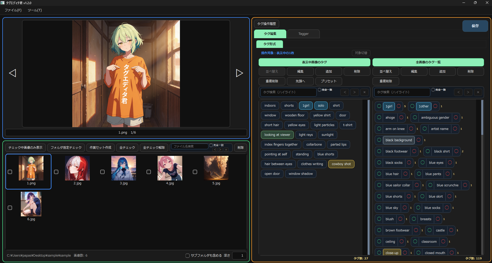

## 主な特徴

- 画像フォルダの読み込み、サムネイル一覧・プレビュー表示
- 画像と同名の `.txt` タグファイルを自動で読み込み・保存
- タグの追加、削除、編集、置換
- チェックした複数画像への一括タグ操作
- タグの含む／含まない条件による画像絞り込み
- 作業対象だけを固定する「作業セット」機能
- タグ操作履歴の確認と、直前から順に戻す機能
- Danbooru系タグ辞書による入力補完
- WD系、PixAI系タガーモデルによるタグ候補生成

## 要件

- Windows
- Python 3.11以上（Python 3.12で動作確認）
- NVIDIA GPU または CPU<br>
  タグ編集だけならCPUでも動作しますが、Taggerの実行にはNVIDIA GPU推奨です

## インストール手順

### 1. リポジトリを取得

このリポジトリを任意のフォルダにクローン

```bat
git clone https://github.com/99a-bc/tag_editor_kun.git
```

### 2. `install.bat` を実行

`install.bat` をダブルクリックして実行します。

途中でPyTorchの実行環境を選択します。<br>
NVIDIA GPUを使う場合は自分の環境に合うCUDA版を選択してください。
必要なPythonライブラリは `install.bat` が自動でインストールします。<br>

### 3. 起動

セットアップ完了後、`run.bat` をダブルクリックします。

### PixAI Tagger v0.9 を使う場合

PixAI Taggerを使う場合だけ、追加で以下を実行してください。

1. Hugging FaceでPixAI Taggerモデルへのアクセス許可を取得
2. Hugging FaceのSettings → Access Tokensで、`Read` 権限のトークンを作成
3. `download_pixai_tagger.bat` を実行し、表示された入力欄へトークンを貼り付けてモデルファイルを取得
4. アプリを再起動し、Taggerタブで `PixAI Tagger v0.9` を選択

入力したトークンは、モデルファイルの取得時だけ使用し、保存されません。

## 基本的な使い方

1. メニューバーの `ファイル` → `画像フォルダを開く...` から、タグ編集したい画像フォルダを選択<br>
   画像またはフォルダをアプリへドラッグ＆ドロップして読み込むこともできます。

2. サムネイルをクリックして画像を選択<br>
   プレビュー画像が切り替わり、左側にその画像のタグが表示されます。

3. 複数画像をまとめて編集したい場合は、対象サムネイルへチェックを付けます<br>
   `Ctrl + クリック` で個別選択、`Shift + クリック` で範囲選択できます。<br>
   `Space` キーでも現在画像のチェックを切り替えられます。

4. 左右のタグパネルから、タグの追加・削除・編集・置換を行います<br>
   チェック画像がある場合、左側の操作はチェックした画像すべてが対象になります。

5. `保存` を押すと、変更したタグを画像と同名の `.txt` ファイルへ保存します。

### タグ編集画面について

#### 左側のタグパネル

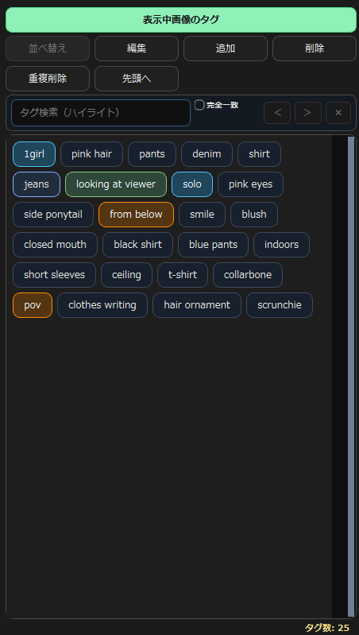

現在選択している画像のタグを表示します。<br>
サムネイルにチェックを付けている時は、チェック中画像に含まれるタグを一覧表示し、追加・削除・編集などをまとめて適用できます。<br>
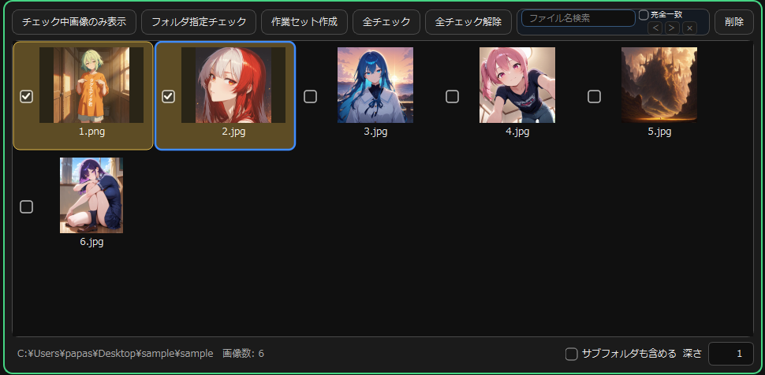 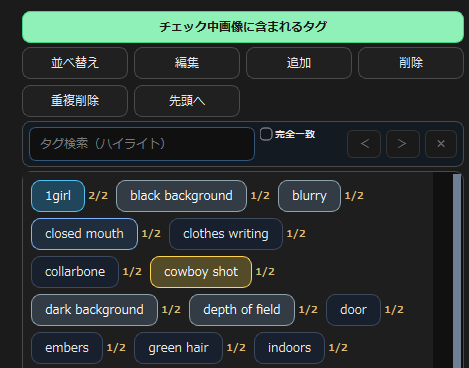

#### 右側のタグパネル

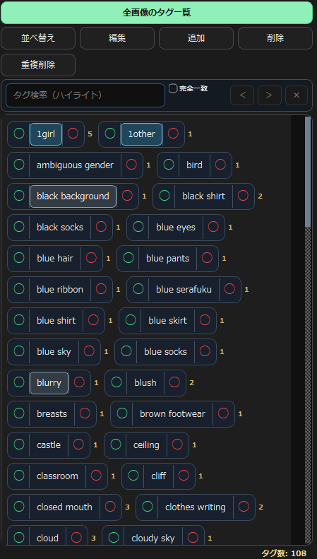

現在読み込んでいるフォルダ内の画像に含まれるタグを一覧表示します。<br>
サブフォルダも含めて読み込んでいる場合は、その配下の画像も対象です。作業セットを作成している時は、作業セット内のタグ一覧に切り替わります。通常は読み込み中の全画像、作業セット中は作業セット内の全画像へ、タグ操作をまとめて適用できます。

### タグチップの操作

左側・右側のタグチップ本体を左クリックすると、タグを選択状態(波線)にできます。<br>
選択したタグは `編集` ボタンから置換・削除できます。複数のタグを選択して、まとめて編集することも可能です。<br>
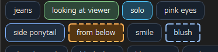

タグチップを右クリックすると、タグのコピーや Google・Danbooru・Gelbooru での検索、Wikiページを開く操作ができます。<br>
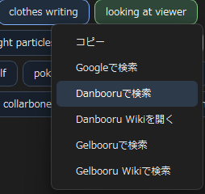

また、左側のタグパネルではタグチップをドラッグ＆ドロップしてタグの並び順を変更できます(サムネイル欄で画像チェック中は不可)<br>
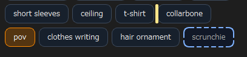


### タグフィルタ
右側タグ一覧の各タグにある緑・赤のボタンで、サムネイル表示を絞り込めます。

* 緑：そのタグを**含む**画像だけを表示
* 赤：そのタグを**含まない**画像だけを表示

複数条件を組み合わせることもできます。<br>
フィルタ中は、右側のタグ一覧と右側からのタグ操作の対象も、絞り込み後に表示されている画像だけになります。

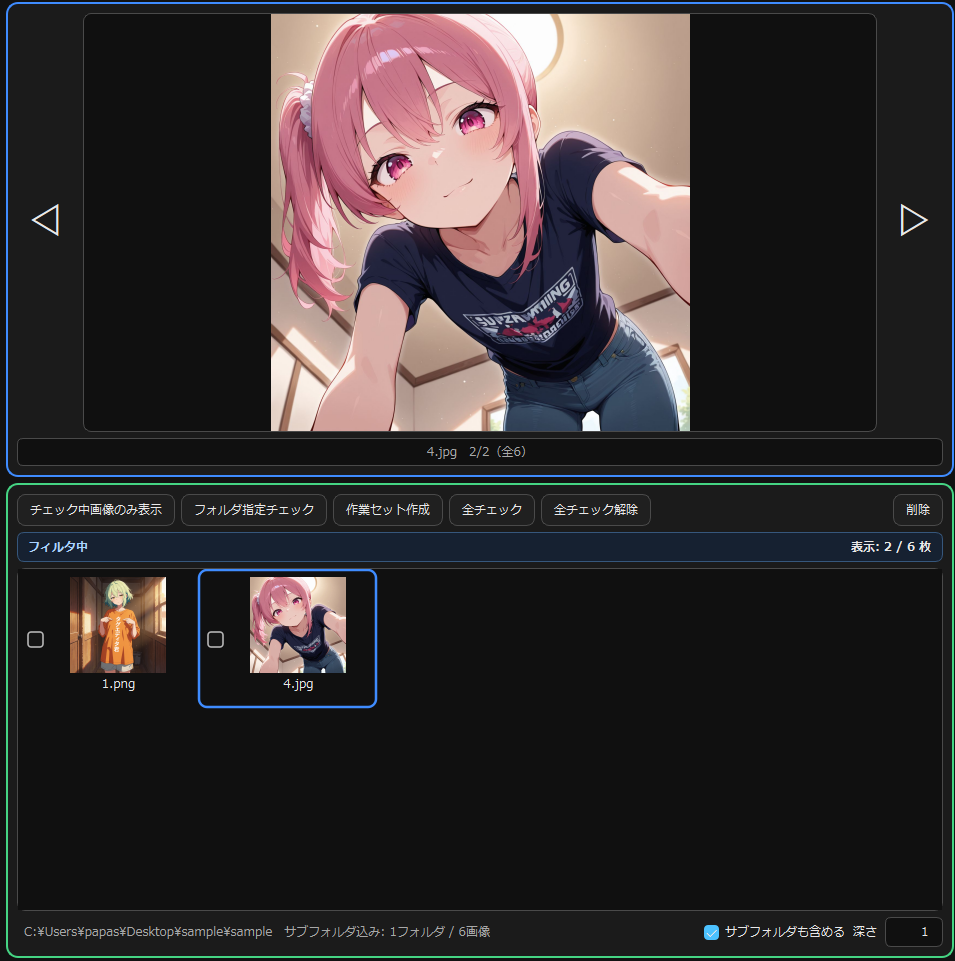 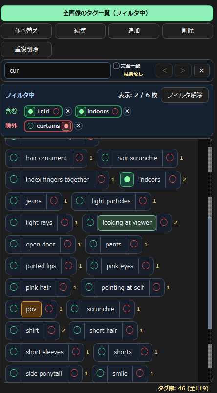
## タグの色分け

タグの一部は、作者の独断と偏見で大まかに分類して色分けしています。
厳密な分類ではなく、タグを見分けやすくするための目安です。すべてのタグが色分けされるわけではありません。

ピンク：キャラ　　藍色：作品　　赤紫：Rating<br>
水色：被写体・人数　　緑：向き・視線　　黄色：人物の写り方<br>
橙：カメラ・視点　　紫：焦点・注目対象　　茶：年代・作風<br>
青灰：画面表現　　色なし：一般・未分類


## Tagger機能
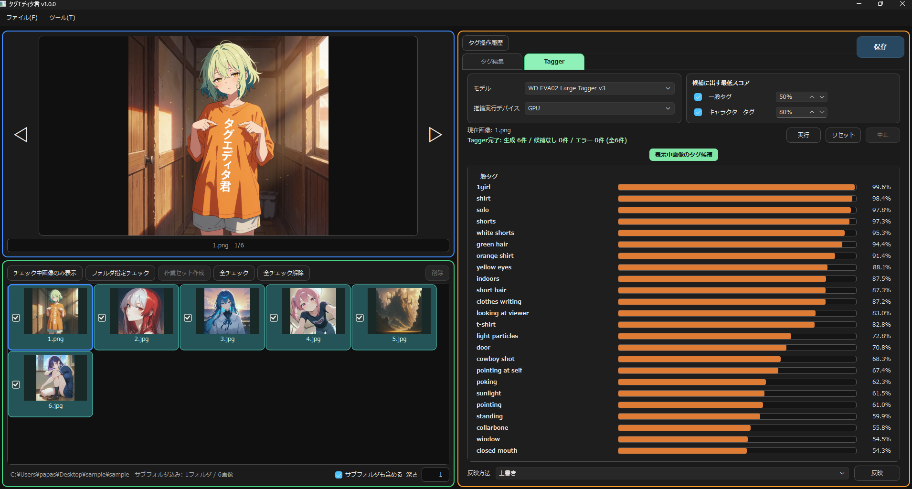

`Tagger` タブから、画像に対するタグ候補を作成できます。
サムネイルで対象画像を選び、モデル・推論実行デバイス・一般タグ／キャラクタータグ/作品タグの最低スコアを設定して 実行 します。<br>
※キャラクタータグ/作品タグはPixAI Taggerモデルのみ選択可能です。

生成後は、現在表示中の画像の候補とスコアを右側で確認できます。
反映方法を指定して `反映` を実行すると、Taggerで候補を生成した画像のタグへ、候補をまとめて反映します。<br>
※Tagger実行後にサムネイルのチェックを外しても、タグ反映対象からは外れません。反映対象から外す場合は`リセット`を押してください。<br>
※`反映` だけでは `.txt` へ保存されません。最後に `保存` を押すと、画像と同名の `.txt` タグファイルへ書き込まれます。

## 今後の予定

- 自然文形式でのタグ編集
- ローカルLLMを利用したタグ候補作成

実装時期は未定です。

## その他

- 大量の画像を含むフォルダでは、初回のサムネイル作成やタグ集計に時間がかかる場合があります。

- GPU版PyTorchが動かない場合は、`install.bat` を再実行して別のCUDA版、またはCPUを選択してください。

- 本アプリはフルスクリーン前提で作成しています<br>
  ウインドウ状態でも動作はしますが、レイアウトなどは考慮していないため、フルスクリーンでの利用をお勧めします。

- 本アプリの利用により生じたいかなる損害についても作者は責任を負いません<br>
  自己責任で利用してください

- Danbooruタグ補完辞書には、`a1111-sd-webui-tagcomplete` の `tags/danbooru.csv` を元にした固定スナップショットを含みます。

- 出典・ライセンス表記は [`THIRD_PARTY_NOTICES.md`](THIRD_PARTY_NOTICES.md) を参照してください。
